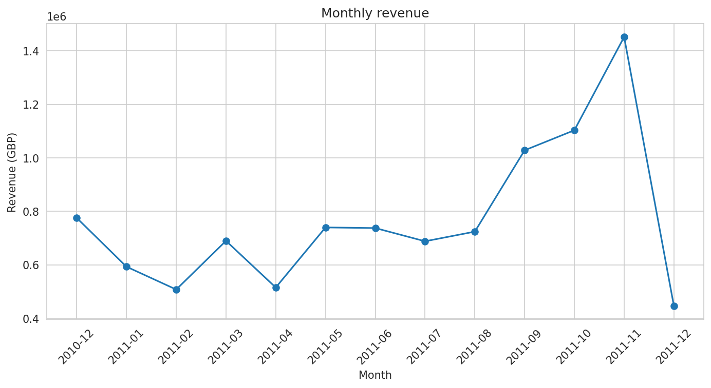
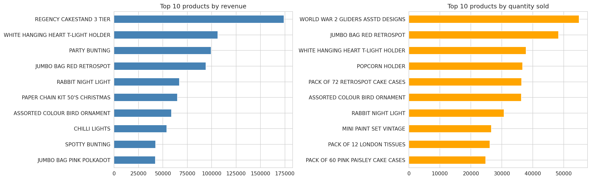
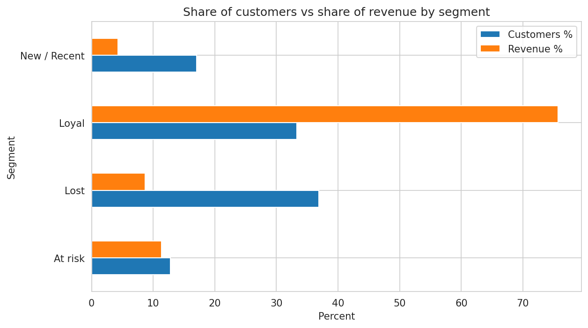

# E-Commerce Sales & Customer Behavior Analysis using Python

An Exploratory Data Analysis (EDA) project on a real-world online retail dataset, developed for the **Bleep EDA Project Assignment (Project 01)**.

## Project Objective

The objective of this project is to analyze an online retail company's sales performance, customer purchasing behavior, product demand, and geographic distribution. Using Python, the project cleans and explores transaction data to identify patterns, generate meaningful insights, and provide actionable business recommendations.

## Dataset

- **Dataset:** UCI Online Retail Dataset
- **Source:** [UCI Machine Learning Repository – Online Retail](https://archive.ics.uci.edu/dataset/352/online+retail)
- **Original size:** 541,909 rows and 8 columns
- **Time period:** 1 December 2010 – 9 December 2011
- **Business context:** A UK-based online gift retailer with many wholesale customers.

### Dataset Columns

- `InvoiceNo` – Invoice number identifying a transaction
- `StockCode` – Product code
- `Description` – Product description
- `Quantity` – Number of items purchased
- `InvoiceDate` – Date and time of the transaction
- `UnitPrice` – Price per unit in GBP
- `CustomerID` – Customer identifier
- `Country` – Customer's country

**Note:** Download `Online Retail.xlsx` from the dataset source before running the notebook.

## Tools and Technologies

- Python
- Pandas
- NumPy
- Matplotlib
- Seaborn
- Google Colab
- Jupyter Notebook

## Analysis Performed

1. **Data Understanding:** Examined dataset dimensions, data types, summary statistics, and column descriptions.
2. **Data Cleaning:** Handled missing values, 5,268 duplicate rows, cancelled invoices, invalid quantities and prices, non-product stock codes, and unusually large orders.
3. **Outlier Analysis:** Used the Interquartile Range (IQR) method and examined extreme quantities and large orders.
4. **Univariate Analysis:** Analyzed quantity, unit price, and order value distributions.
5. **Bivariate and Multivariate Analysis:** Explored price versus quantity, customer frequency versus spending, order value by country and weekday, and weekday-hour patterns.
6. **Time-Series Analysis:** Investigated monthly and weekly revenue trends.
7. **Customer Analysis:** Identified top customers and grouped customers according to purchasing behavior.
8. **Correlation Analysis:** Examined relationships between numerical variables using Spearman correlation.
9. **Cancellation Analysis:** Investigated cancellation rates and their estimated financial impact.
10. **Product Demand Analysis:** Identified products with increasing and decreasing quantity trends.

## Dataset Summary After Cleaning

- **Sales rows:** 522,502
- **Orders:** 19,771
- **Identified customers:** 4,333
- **Products:** 3,993
- **Countries:** 38
- **Total revenue:** Approximately GBP 10.0 million

These figures reflect the filtering and cleaning process used in the analysis.

## Key Findings

### 1. Top-Performing Products

The products generating the highest revenue were:

| Product | Revenue (approx.) |
|---|---:|
| Regency Cakestand 3 Tier | GBP 174,157 |
| White Hanging Heart T-Light Holder | GBP 106,237 |
| Party Bunting | GBP 99,445 |

The highest-selling products by quantity included:

- **World War 2 Gliders:** 54,951 units
- **Jumbo Bag Red Retrospot:** 48,371 units

Revenue and quantity provide different perspectives on product performance and can both support inventory planning.

### 2. Geographic Revenue Distribution

The United Kingdom contributes approximately **84.8% of total revenue**.

| Country | Revenue Share |
|---|---:|
| United Kingdom | 84.8% |
| Netherlands | 2.8% |
| EIRE | 2.7% |
| Germany | 2.1% |
| France | 1.8% |

The results show a strong dependence on the UK market, while other countries offer potential opportunities for international growth.

### 3. Monthly Sales Trends

Revenue increases significantly during the autumn months.

| Period | Approximate Monthly Revenue |
|---|---:|
| January–August | GBP 0.50M–0.74M |
| September | GBP 1.03M |
| October | GBP 1.10M |
| November | GBP 1.45M |

November recorded the highest monthly revenue in the analyzed period. December 2011 is incomplete, and the dataset covers only about one year, so recurring yearly seasonality cannot be confirmed.

### 4. Order Value Analysis

- **Average order value:** Approximately GBP 505.85
- **Median order value:** Approximately GBP 302.20

The average is higher than the median, suggesting that a relatively small number of high-value orders influence the overall average. Wholesale purchases may contribute to this difference.

### 5. Ordering Patterns

- Thursday recorded the highest number of orders, with 4,209.
- Order activity peaked around 12 noon.
- No Saturday orders appeared in the analyzed data.

These observations can help guide promotional timing, but the absence of Saturday orders should be checked against the original data and cleaning process.

### 6. Customer Behavior

- The top 20% of customers generated approximately 73.9% of revenue.
- The **Loyal** segment represented approximately 33% of customers and contributed 75.7% of customer revenue.
- Approximately 555 customers were classified as **At Risk**, with historical spending of about GBP 961,000.

These findings highlight the importance of retaining valuable customers and re-engaging customers whose purchasing activity has declined.

### 7. Price and Quantity Relationship

The Spearman correlation between unit price and quantity was approximately **-0.41**, indicating a moderate negative association.

The median quantity was 12 units for the cheapest items and 2 units for the most expensive items. This suggests that lower-priced products tend to be purchased in larger quantities, although correlation does not establish causation.

### 8. Cancellation Analysis

- Approximately 14.8% of invoices were cancelled.
- The estimated value associated with cancellations was approximately GBP 894,000.
- Cancellation rates varied across countries, with higher rates reported in Germany, EIRE, and Belgium than in the UK.

These findings indicate that cancellation behavior deserves further investigation. The financial impact depends on the cancellation-value calculation and filtering rules used.

### 9. Product Demand Trends

Products showing positive monthly quantity trends included:

- Christmas Paper Chain Kit: approximately +2,411 units per month
- Jumbo Bag Red Retrospot: approximately +1,218 units per month
- Bird Ornament: approximately +1,156 units per month

Products showing negative monthly quantity trends included:

- White Hanging Heart T-Light Holder: approximately -802 units per month
- Regency Cakestand: approximately -183 units per month

These trends describe the analyzed period and should not automatically be interpreted as long-term changes in product popularity.

## Visualizations

The project includes visualizations to explore sales patterns, product performance, and customer behavior.

### Monthly Revenue



### Top Products by Revenue



### Customer Segments



## Business Insights and Recommendations

1. **Plan inventory for the autumn peak:** Prepare stock for popular and seasonal products before the September–November revenue increase.
2. **Retain loyal customers:** Introduce loyalty rewards and personalized offers for valuable customers.
3. **Re-engage at-risk customers:** Consider targeted campaigns for previously active customers whose purchasing activity has declined.
4. **Explore international markets:** Investigate opportunities in the Netherlands, EIRE, Germany, and France while considering costs, cancellations, and profitability.
5. **Optimize promotional timing:** Use observed weekday and midday purchasing patterns to guide promotional experiments.
6. **Review product pricing and bundling:** Explore bundles for lower-priced products that tend to sell in larger quantities.
7. **Investigate declining product trends:** Examine pricing, stock availability, seasonality, and customer preferences for products with decreasing quantities.
8. **Investigate cancellations:** Review cancellation patterns by product, country, and order size before proposing operational changes.
9. **Improve customer data collection:** Reduce missing CustomerID values where possible to support more complete customer-level analysis.

## Limitations

- The dataset covers approximately one year, so recurring yearly seasonality cannot be confirmed.
- December 2011 is incomplete.
- Approximately 25% of rows have missing CustomerID values, limiting customer-level analysis.
- Many orders involve wholesale purchasing behavior, so findings may not generalize to a typical retail shop.
- Cancellation estimates depend on the definitions and filtering rules used during cleaning.
- Product demand trends are based on a limited observation period.
- This is an exploratory analysis; correlation does not prove causation.

## Repository Structure

```text
├── Project01_Ecommerce_EDA_Colab.ipynb
├── EDA_Report_Project01.pdf
├── Presentation.pptx
├── figures/
│   ├── 02_top_products.png
│   ├── 05_monthly_revenue.png
│   └── 12_customer_segments.png
└── README.md
```

Ensure the repository contains the files and figures listed above, with matching filenames.

## How to Run

1. Download `Online Retail.xlsx` from the [UCI Online Retail Dataset page](https://archive.ics.uci.edu/dataset/352/online+retail).
2. Open `Project01_Ecommerce_EDA_Colab.ipynb` in Google Colab.
3. Upload the dataset when prompted by the notebook, or update the file path to match your setup.
4. Select **Runtime → Run all**.
5. Review the generated tables, visualizations, and analysis results.

## Resume Description

Analyzed 500K+ e-commerce transactions using Python, Pandas, NumPy, Matplotlib, and Seaborn to identify sales trends, top-performing products, geographic revenue distribution, customer segments, and cancellation patterns, and developed data-driven recommendations for inventory planning, customer retention, and international growth.

## Author

**Anunay Kumar Sah**  
B.Tech CSE, ITER (SOA)

GitHub: [https://github.com/aksah20](https://github.com/aksah20)
